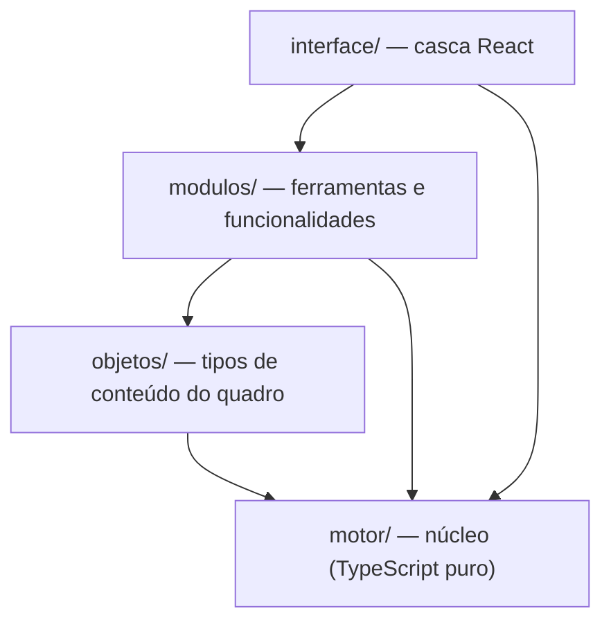

# Arquitetura Técnica — Maia Class

Manual técnico principal para quem programa (humanos e IAs). Complementa:
[requisitos.md](requisitos.md) (o quê) · [plano-completo.md](plano-completo.md) (quando) · [decisoes.md](decisoes.md) (por quê) · [dependencias.md](dependencias.md) (com quais peças) · [design-system.md](design-system.md) (com que cara).

> Os trechos de código abaixo são **esboços de contrato** para orientar a implementação, não código final.

---

## 1. Camadas e regra de dependência



| Camada | Pode importar | **Não pode** importar |
|---|---|---|
| `motor/` | Nada do projeto (só bibliotecas aprovadas, exceto React) | React, `objetos/`, `modulos/`, `interface/` |
| `objetos/` | `motor/api` | React, `modulos/`, `interface/`, outro objeto* |
| `modulos/X/` | `motor/api`, `objetos/*` (pela porta pública de cada um) | **outro módulo**, internos do motor |
| `interface/` | `motor/api`, registro de módulos | internos de módulos e objetos |

\* Se dois objetos precisarem compartilhar algo, isso vai para `motor/geometria/`.

- `motor/api.ts` é a **única porta de entrada** do motor. Nada importa arquivos internos do motor diretamente.
- Arquivos `.tsx` (React) só podem existir em `interface/` e nos `painel.tsx` dos módulos.
- A regra é verificada automaticamente por **dependency-cruiser** (D-15). Violação = verificação falha.

---

## 2. Estrutura de pastas

```
Maia Class/
├── AGENTS.md · CLAUDE.md        regras para IAs
├── docs/                        documentação (nada daqui entra no app)
└── app/                         o produto
    ├── index.html
    ├── public/                  ícones, fontes empacotadas (D-17)
    └── src/
        ├── main.tsx             ponto de partida
        ├── motor/
        │   ├── api.ts           porta pública única
        │   ├── camera/          posição, zoom, andares de escala
        │   ├── documento/       modelo Yjs, transações, desfazer/refazer, persistência
        │   ├── entrada/         ponteiros, pressão, palma, previsão, tinta delegada, botões
        │   ├── pintor/          camadas, superfícies (tela/PDF/imagem), recorte do visível
        │   ├── geometria/       contas puras reutilizáveis (com testes)
        │   ├── registro/        a "tomada" onde módulos e objetos se inscrevem
        │   └── eventos/         barramento de eventos do motor
        ├── objetos/
        │   ├── traco/           traço de caneta e marca-texto
        │   ├── forma/           formas paramétricas (polígono, elipse, seta, reta...)
        │   ├── texto/           caixa de texto
        │   ├── imagem/
        │   ├── pagina-pdf/
        │   └── preenchimento/   região vetorial preenchida
        ├── modulos/             um por funcionalidade (ver §4)
        │   ├── caneta/  marca-texto/  borracha/  selecao/  formas/  preencher/
        │   ├── texto/  importar/  exportar/  pagina/  biblioteca/
        │   ├── botao-caneta/  gestos/  caligrafia/  colaboracao/ (em espera)
        └── interface/           casca React: menu (dock), janelas, configurações gerais, tema
```

Testes ficam **ao lado** do arquivo testado (`camera.test.ts` junto de `camera.ts`).

---

## 3. Contratos do registro (a "tomada")

### 3.1 Ficha de inscrição de um módulo

```ts
interface FichaModulo {
  id: string;                     // 'caneta'
  nome: string;                   // 'Caneta'
  ativoPorPadrao: boolean;        // colaboracao = false
  ferramenta?: Ferramenta;        // se aparece como ferramenta selecionável
  painel?: () => Promise<ComponentePainel>; // menu de opções (React), carregado sob demanda
  configuracoesPadrao?: object;   // opções persistidas do módulo
  atalhos?: Atalho[];             // teclado (Ctrl+Z etc.)
  iniciar?(api: ApiMotor): Desligar; // para módulos sem ferramenta (ex.: gestos)
}

interface Ferramenta {
  aoPressionar(e: EventoCaneta, api: ApiMotor): void;
  aoMover(e: EventoCaneta, api: ApiMotor): void;
  aoSoltar(e: EventoCaneta, api: ApiMotor): void;
  aoCancelar(api: ApiMotor): void;
  desenharPrevia?(sup: Superficie, api: ApiMotor): void; // camada molhada
}
```

### 3.2 Ficha de um tipo de objeto

```ts
interface TipoObjeto<T extends ObjetoBase> {
  tipo: string;                                   // 'traco'
  desenhar(obj: T, sup: Superficie, ctx: ContextoDesenho): void; // tela, PDF e imagem
  limites(obj: T): Retangulo;                     // para índice espacial e seleção
  acerta(obj: T, regiao: Regiao): 'total' | 'parcial' | 'nenhum'; // seleção / borracha
  transformar(obj: T, m: Matriz): Partial<T>;     // mover, girar, redimensionar
  cortar?(obj: T, regiao: Regiao): T[];           // borracha parcial (se suportado)
}
```

Ferramentas operam sobre objetos **somente por esses contratos**. Exemplo: a borracha chama `cortar()` sem saber se o objeto é traço ou forma.

### 3.3 Janelas no quadro (plugins futuros)
Um módulo pode registrar um tipo de objeto "janela": um elemento redimensionável ancorado no espaço do quadro (ex.: editor de funções). Enquanto não está em edição, é desenhado como imagem no Canvas, para respeitar a ordem frente/trás e a exportação.

---

## 4. Modelo de dados (Yjs)

```ts
interface ObjetoBase {
  id: string;
  tipo: string;            // 'traco' | 'forma' | 'texto' | 'imagem' | 'paginaPdf' | 'preenchimento' | tipos de plugins
  andar: number;           // andar de escala (§5)
  x: number; y: number;    // origem do objeto dentro do andar
  rotacao: number;
  escala: number;
  ordem: string;           // índice fracionário (ex.: 'a0', 'a0V'): frente/trás sem renumerar tudo
  bloqueado?: boolean;
}

type ReferenciaCor = `paleta:${string}` | `#${string}`; // D-18

interface Traco extends ObjetoBase {
  tipo: 'traco';
  pontos: Float32Array;    // [x, y, pressão, inclinaçãoX, inclinaçãoY, tempo] relativos à origem
  ferramenta: 'caneta' | 'marcaTexto';
  modo: 'fluido' | 'uniforme';
  estilo: 'continuo' | 'pontilhado' | 'tracejado';
  cor: ReferenciaCor;
  opacidade: number;       // marca-texto: cor opaca + opacidade separada
  espessura: number;       // SEMPRE em unidades do quadro
}
```

**Regras:**
- Espessura "real" e "virtual" são só modos do controle deslizante. Ambas são convertidas e salvas em unidades do quadro: real → `px / zoomAtual`; virtual → `px` (relativo ao zoom de 100%).
- Cores da paleta são salvas como referência (`paleta:preto`) e resolvidas na hora de desenhar, conforme o tema (D-18).
- Todo `Y.Map`/`Y.Array` do documento é alterado dentro de `documento.transacao(...)`, para o desfazer agrupar corretamente.
- Configurações do caderno (fundo, cor do papel, tela infinita, molduras A4) ficam no próprio documento Yjs. Preferências do usuário (função do botão, tema) ficam fora dele, no armazenamento local.

---

## 5. Câmera e zoom infinito ("andares de escala")

- A câmera guarda `andar`, `x`, `y` e `zoom` **relativos ao andar atual**.
- Cada andar é 1.000× menor que o anterior. Quando o zoom passa de 1.000, a câmera desce um andar (zoom ÷ 1.000, posição convertida); quando cai abaixo de 1/1.000, sobe um andar.
- Objetos guardam o andar em que foram criados. O pintor desenha objetos do andar atual e dos andares vizinhos (convertendo escala); andares muito distantes ficam invisíveis (pequenos demais ou grandes demais).
- Toda conta de desenho é feita **relativa à câmera** (subtraindo a posição da câmera antes de multiplicar pelo zoom), para não perder precisão.
- Fase 1: um único andar (zoom de 0,01× a 1.000×). Fase 3: troca de andares. O campo `andar` existe desde a Fase 1.

---

## 6. Entrada (caneta, dedo, mouse)

Fluxo: `PointerEvent` → **filtro de palma** → normalização (`EventoCaneta`) → ferramenta ativa.

- **Rejeição de palma (D-19):** enquanto houver caneta próxima ou em contato (pen hover/down nos últimos ~500 ms), toques de dedo não desenham. Por padrão, o dedo só navega (arrastar e pinça).
- **Pontos intermediários:** usar `getCoalescedEvents()` para capturar todos os pontos da caneta.
- **Previsão:** `getPredictedEvents()` alimenta só a camada molhada (nunca é salvo).
- **Tinta delegada:** `navigator.ink.requestPresenter()` quando disponível (Chrome/Edge/Samsung Internet, **só em conexão segura**, D-22).
- **Botões:** botão lateral = `button === 2` / bit 2 em `buttons`; ponta-borracha da Wacom = `button === 5` / bit 32. No Chrome Android, o botão da S Pen só é confiável com a caneta pairando (limitação do navegador; resolvida no app Android).
- **"Segurar parado" (Extra 1):** se a caneta ficar parada (deslocamento < ~3 px de tela) por ~600 ms antes de soltar, o motor emite o evento `traco:segurado` e o módulo `formas` decide se corrige.
- Cancelamento: `pointercancel` e entrada de segundo dedo durante um traço → `aoCancelar()`.

---

## 7. Pintor

**Três camadas de Canvas empilhadas:**
1. **Fundo:** papel, grade, linhas, pontilhado, partitura, molduras A4. Redesenha só quando a câmera ou a configuração muda.
2. **Tinta seca:** todos os objetos. Redesenha quando a câmera ou o documento muda, desenhando apenas o que está visível (índice espacial `rbush`, Fase 3).
3. **Tinta molhada:** só o traço em andamento + prévias das ferramentas. Contexto com `desynchronized: true`. Redesenha a cada movimento da caneta.

**Uma interface, três destinos:** todo desenho passa por `Superficie` (subconjunto do Canvas 2D: caminhos, preenchimento, traço, texto, imagem). Implementações: tela (Canvas), PDF vetorial (jsPDF) e imagem (Canvas fora da tela). Assim, a exportação é idêntica à tela.

**Nível de detalhe:** em zoom baixo, simplificar os pontos do traço antes de desenhar (redução proporcional ao tamanho na tela); em zoom alto, usar todos os pontos.

**Marca-texto:** desenhado numa passagem própria, atrás da tinta da caneta, com opacidade aplicada ao traço inteiro (sem escurecer onde o traço passa sobre si mesmo).

**Metas de desempenho** (no Galaxy Tab S6 Lite):
- Camada molhada: < 4 ms por quadro.
- Navegação (arrastar/zoom) a 60 FPS com 5.000 traços na tela; 20.000 traços no caderno (Fase 3).
- Sem criar objetos novos dentro do laço de desenho (reaproveitar memória).

---

## 8. Persistência e cadernos

- Cada caderno = um documento Yjs, salvo no IndexedDB (`y-indexeddb`).
- O módulo `biblioteca` lista, cria, renomeia e apaga cadernos (D-20).
- Ao abrir o app, pedir `navigator.storage.persist()` (D-21).
- Backup: exportar/importar caderno como arquivo `.maia` (estado Yjs + imagens/PDFs embutidos).
- Imagens e PDFs importados são guardados como arquivos binários separados (referenciados por id), não dentro de cada objeto.

---

## 9. Desfazer / refazer

`Y.UndoManager` sobre o documento, com origem rastreada: cada ação de ferramenta é uma transação (um traço = um passo de desfazer). Na colaboração futura, cada pessoa desfaz só as próprias ações.

---

## 10. Tela finita, páginas A4 e PDF

- "Tela infinita" desligada: a câmera fica limitada às páginas existentes.
- Molduras A4 (210 × 297 unidades × fator fixo): desenhadas no fundo; definem as páginas da exportação em PDF.
- Importar PDF: cada página vira um objeto `paginaPdf` (renderizado por pdf.js na resolução do zoom atual) e a tela infinita é desligada automaticamente.

---

## 11. Testes

- **Vitest** para tudo de `motor/geometria/`, câmera, conversões de espessura, reconhecimento de formas, corte da borracha, ângulos e focos.
- **Playwright** para fluxos no navegador (desenhar traço simulado, zoom de 0,01× a 1.000×, comparação de capturas).
- **dependency-cruiser** para a regra de camadas.
- Comando único de verificação (a definir na Fase 0): compila + testes + regra de camadas. **Nenhuma tarefa é dada como concluída sem passar nele.**
