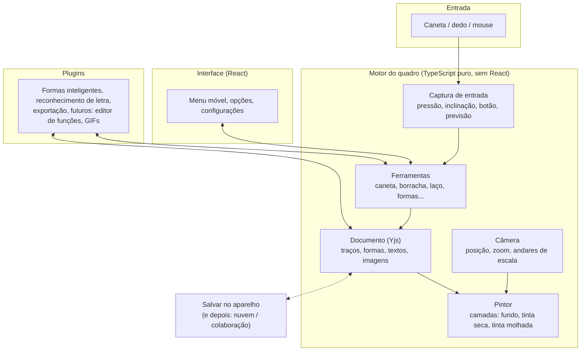

# Plano de Desenvolvimento — Quadro Infinito "Maia Class"

## Objetivo

Criar um caderno/quadro branco infinito para escrever à mão com caneta (S Pen, Apple Pencil, mesa digitalizadora). Ele precisa ter:

- **zoom infinito**, sem o traço ficar pixelado;
- ferramentas de desenho, formas inteligentes, texto, PDF e exportação;
- possibilidade de virar **app Android** e ter **colaboração em tempo real** no futuro.

Você vai construir tudo com *vibe coding*. Por isso, cada decisão abaixo também levou em conta o seguinte: **a IA consegue programar e consertar isso com segurança?**

---

## 1. As grandes decisões (resumo)

| Tema | Decisão | Por quê, em uma frase |
|---|---|---|
| Onde roda | **Navegador primeiro**, depois o mesmo código vira app Android | Um código só para manter |
| Linguagem | **TypeScript** (JavaScript com "corretor ortográfico") | A IA erra menos, porque os erros aparecem antes de você testar |
| Motor do quadro | **Feito sob medida**, usando peças prontas e gratuitas | Nenhum motor pronto tem zoom infinito "para dentro" + licença livre |
| Como o desenho é pintado na tela | **Canvas** (uma "tela de pintura" do navegador), redesenhada a partir dos dados do traço | Traço sempre nítido em qualquer zoom e baixa latência |
| Onde os dados ficam | **Yjs** (um "caderno de dados" feito para colaboração), salvo no próprio aparelho | Já nasce pronto para a Prioridade 3, sem reescrever nada |
| Menus e botões | **React** | É o que a IA mais conhece, então menos erros |
| Android | **Mesmo código web, "embrulhado" num app (Capacitor)**, com uma peça nativa pequena só para a tinta e o botão da S Pen | Respondo sua pergunta na [seção 4](#4-sua-pergunta-sobre-o-android) |
| Colaboração | **Liveblocks** (serviço pronto) usando o mesmo Yjs | Já traz os níveis visualizar / comentar / editar |
| Ferramenta de vibe coding | **Antigravity (este ambiente) + Git/GitHub** | Um projeto gráfico sob medida precisa de uma IA que rode, teste e corrija no seu computador |
| Publicação na internet | **Cloudflare Pages** (gratuito) | Link HTTPS para testar no tablet e celular |

---

## 2. Por que essas escolhas (opções investigadas)

### 2.1 Usar um quadro pronto ou construir o nosso?

| Opção | Prós | Contras | Veredito |
|---|---|---|---|
| **tldraw** | Muito polido, tem pressão da caneta | **Licença paga** para uso comercial (ou marca d'água "made with tldraw"). Zoom limitado. Personalizar a borracha parcial, a régua de ângulos etc. é brigar com o motor | ❌ |
| **Excalidraw** | Gratuito | Feito para diagramas, não para escrita à mão. Zoom limitado (até 30x) | ❌ |
| **Konva / Fabric / Pixi** (bibliotecas gráficas genéricas) | Ajudam a desenhar | Não resolvem o zoom infinito nem a latência. Acabaríamos reescrevendo metade | ❌ |
| **Motor próprio + peças prontas** | Controle total sobre latência, zoom infinito, formatos e plugins | Mais trabalho no início | ✅ **Escolhido** |

As "peças prontas" (todas gratuitas e de código aberto) que vamos usar:
- **perfect-freehand**: transforma pontos e pressão da caneta num traço bonito (modo "fluido").
- **Yjs**: guarda os dados, faz o desfazer/refazer e, no futuro, a colaboração.
- **pdf.js** (da Mozilla): abre PDFs nítidos em qualquer zoom.
- **jsPDF**: exporta PDF **vetorial**, ou seja, o traço continua nítido dentro do PDF.
- **rbush**: um "índice" que encontra rapidamente quais traços estão visíveis, para não desenhar o que está fora da tela.

### 2.2 Como garantir que o traço não fica pixelado
Cada traço é guardado como uma **receita**, e não como uma foto: a lista de pontos, a pressão em cada ponto, a cor, a espessura e o estilo. A cada zoom, a tela é **repintada a partir da receita**, na resolução exata da tela. É por isso que dá para ampliar 1.000x e o traço continua liso.

> [!NOTE]
> **Zoom realmente infinito.** O computador tem um limite de casas decimais. Num zoom absurdo (um milhão de vezes ou mais), os pontos começariam a "tremer". A solução vai ser feita na Fase 3: dividir o mundo em **"andares de escala"**, como bonecas russas. Ao passar de certo zoom, a câmera "desce um andar" e as contas recomeçam com números pequenos. Desde o primeiro dia, cada objeto já guarda em qual "andar" está, então nada precisa ser refeito depois.

### 2.3 Como chegar perto da "latência zero" no navegador
Latência zero de verdade não existe. A meta é que **o traço pareça colado na ponta da caneta**. Quatro técnicas, combinadas:
1. **Duas camadas de tela.** Uma camada leve desenha só o traço que está sendo feito agora ("tinta molhada"). A outra guarda todo o resto ("tinta seca"). Assim, nunca é preciso redesenhar o quadro inteiro enquanto você escreve.
2. **Modo "sem espera" da tela.** O navegador entrega o desenho direto, sem sincronizar com o resto da página.
3. **Todos os pontos da caneta.** A caneta envia mais pontos do que a tela mostra, e capturamos todos. Também usamos a **previsão** de onde a caneta vai estar no próximo instante.
4. **Tinta delegada.** No Chrome, Edge e Samsung Internet, o sistema operacional desenha a pontinha do traço antes mesmo do nosso código. Isso funciona no **Chrome para Android** e no Windows.

> [!IMPORTANT]
> No fim da Fase 1 haverá um **teste de latência no seu tablet de verdade**. Esse é o momento-chave do projeto: se a sensação for boa, seguimos. Se não for, antecipamos a peça nativa do Android (seção 4).

### 2.4 Espessura "real" e "virtual"
As duas são salvas do mesmo jeito. Muda apenas a forma como o controle deslizante se comporta:
- **Real**: "quero 3 px **na tela agora**". Se você estiver com zoom de 400%, o traço é salvo 4x mais fino no quadro.
- **Virtual**: "quero 3 px **como se o zoom fosse 100%**".

---

## 3. Arquitetura (o "esqueleto" do programa)



**Princípio que mantém o código limpo para extensões:** *toda ferramenta é um plugin*, inclusive a caneta e a borracha. Um plugin pode:
- registrar uma **ferramenta** (que aparece no menu);
- registrar um **tipo de objeto** (que sabe se desenhar, ser selecionado e ser exportado);
- abrir uma **janela redimensionável** dentro do quadro (por exemplo, o futuro editor de funções matemáticas).

Se as ferramentas principais usam a mesma "tomada" que os plugins futuros, essa tomada com certeza vai funcionar quando chegar a hora.

**Um pintor, três destinos:** o mesmo código que pinta na tela também "pinta" dentro do PDF (vetorial) e da imagem exportada. Assim a exportação fica idêntica ao que você vê.

---

## 4. Sua pergunta sobre o Android

> *"O aplicativo deve ser mantido em HTML, CSS e JavaScript? Ou a parte do quadro deve ser reescrita em outra linguagem?"*

**Resposta: fica tudo em HTML, CSS e JavaScript (TypeScript). Só a "tinta molhada" ganha uma peça nativa pequena, e apenas se o teste mostrar que é necessário.**

| Opção | Latência S Pen | Botão da S Pen | Trabalho | Veredito |
|---|---|---|---|---|
| **A. PWA** (o site "instalado" como app pelo Chrome) | Boa (tem tinta delegada) | ⚠️ Só funciona com a caneta pairando, não encostada | Quase zero | ✅ 1º passo |
| **B. Capacitor** (o site dentro de um app de verdade) **+ peça nativa de tinta** (biblioteca oficial do Android, ~4 ms) | Excelente | ✅ Funciona sempre | Médio: 95% do código é compartilhado | ✅ **Destino final** |
| C. Reescrever tudo em Kotlin (nativo) | Excelente | ✅ | Enorme: dois programas para manter, e a colaboração precisaria ser refeita | ❌ |
| D. Flutter / React Native | Boa | ✅ | Reescrever tudo, sem ganho real | ❌ |

Como funciona a opção B: quando a S Pen toca a tela, uma camada nativa transparente desenha o traço instantaneamente. Quando você levanta a caneta, ela entrega os pontos para o nosso código web, que guarda e exibe o traço "seco". É o mesmo truque dos melhores apps de notas.

A mesma peça nativa resolve também o **botão da S Pen** e o **reconhecimento de letra offline e gratuito** (Google ML Kit).

---

## 5. Pontos de atenção (limitações reais)

> [!WARNING]
> **Botão da S Pen no navegador (Funções Extras 2 e 3):** o Chrome do Android intercepta o botão quando a caneta está encostada na tela. No navegador, as funções do botão vão funcionar **com a caneta pairando** e em **mesas digitalizadoras no PC** (Wacom etc.). A versão completa, com o botão pressionado durante o traço, vem no app Android (Fase 10). O **Apple Pencil** não tem botão acessível pelo navegador. No iPad, vamos oferecer um atalho alternativo (por exemplo, toque com dois dedos).

> [!WARNING]
> **Reconhecimento de letra (Função Extra 5b) no navegador:** não existe reconhecedor embutido no Chrome do Android nem do PC. Opções:
> - **Web:** enviar o trecho escrito para a IA do Google (Gemini), que lê bem letra cursiva em português e fórmulas. Custo de centavos por mês para uso pessoal, exige internet.
> - **App Android:** Google ML Kit, gratuito e offline.
>
> Vamos construir o reconhecimento como uma peça "trocável", para usar o melhor de cada plataforma.
>
> Já o **endireitar linhas (5a)** não precisa ler as letras. Dá para fazer só com geometria (achar a linha de base e alinhar), então funciona offline em todo lugar.

> [!NOTE]
> **Preencher (balde de tinta):** em formas reconhecidas, o preenchimento é perfeito. Em contornos feitos à mão, o programa detecta a região fechada e cria uma "mancha" **vetorial** que a preenche. Ela também não pixela.

---

## 6. Etapas de desenvolvimento

Cada fase termina com **algo que você consegue testar no tablet**. Nada avança sem teste.

```mermaid
flowchart LR
    F0["0 Preparação"] --> F1["1 Caneta + câmera<br/>TESTE DE LATÊNCIA"]
    F1 --> F2["2 Marca-texto, borracha,<br/>seleção"]
    F2 --> F3["3 Zoom infinito real<br/>+ desempenho"]
    F3 --> F4["4 Formas inteligentes<br/>+ preencher"]
    F4 --> F5["5 Texto, imagens, PDF,<br/>configurações de página"]
    F5 --> F6["6 Exportar"]
    F6 --> F7["7 Menu móvel, botão,<br/>gestos"]
    F7 --> F8["8 Letra: alinhar<br/>e reconhecer"]
    F8 --> F9["9 Plugins<br/>(1º exemplo)"]
    F9 --> F10["10 App Android"]
    F10 --> F11["11 Colaboração"]
```



| Fase | O que entrega | Itens do seu pedido |
|---|---|---|
| **0. Preparação** | Ferramentas instaladas, projeto criado, regras para a IA, backup no GitHub, link de teste na internet | — |
| **1. Caneta + câmera** | Quadro infinito com arrastar/zoom (pinça, roda do mouse); caneta fluida e uniforme, cores, espessura real/virtual, pontilhado/tracejado; desfazer/refazer; salvamento automático; fundos (liso, grade, pontilhado, linhas, partitura). **Medidor de latência** | Caneta 1a–c, Config. 9a |
| **2. Edição básica** | Marca-texto (fica atrás da tinta); borracha parcial e de traço inteiro; seleção por laço/retângulo, opção "parcialmente selecionados", mover, redimensionar, girar, trazer para frente/enviar para trás | 2, 3, 4 |
| **3. Zoom infinito real** | "Andares de escala"; teste de estresse com 20 mil traços sem engasgar | Zoom infinito |
| **4. Formas inteligentes** | Reconhecer reta, seta, círculo/elipse, polígonos de 3 a 10 lados, estrela, coração; deixar regular quando a forma estiver próxima; segurar a caneta parada no fim do traço para corrigir; alças nos vértices; mostrar ângulos; polígono regular; centro/focos e distância focal; pontas de seta; balde de tinta | 5, 6, Extra 1 |
| **5. Conteúdo** | Caixa de texto (desenhar a área antes; fonte, tamanho, negrito, itálico, sub/sobrescrito, sublinhado, cor, alinhamento); importar imagens e PDF (o PDF desliga a tela infinita); modo noturno, cor de fundo, molduras A4, liga/desliga tela infinita | 7, 8, 9 |
| **6. Exportar** | Imagem (você enquadra a área); PDF vetorial respeitando as molduras A4 (ou criando-as automaticamente) | 10 |
| **7. Menus e caneta** | Menu arrastável para as quatro bordas; configuração da função do botão; gestos que abrem mini-menus ao lado da caneta | Extras 2, 3, 4 |
| **8. Caligrafia** | Endireitar linhas e tamanhos; selecionar texto manuscrito e transformá-lo em caixa de texto | Extra 5 |
| **9. Plugins** | Formalizar a "tomada" de plugins e criar um 1º plugin de exemplo (uma janela com gráfico de função) | Extra 6 |
| **10. Android** | PWA instalável; depois app Capacitor com tinta nativa, botão da S Pen completo e reconhecimento offline | Prioridade 2 |
| **11. Colaboração** | Contas, link de compartilhamento, permissões (visualizar/comentar/editar), cursores dos colegas ao vivo | Prioridade 3 |

> [!TIP]
> **Ordem pensada para reduzir risco:** primeiro atacamos o que pode inviabilizar o projeto (latência e zoom, Fases 1 e 3). As funcionalidades "bonitas" vêm depois, sobre uma base comprovada.

---

## 7. Como vamos trabalhar no vibe coding (regras de ouro)

1. **Um pedido por vez, pequeno.** "Adicionar pontilhado na caneta" é melhor do que "fazer a caneta toda".
2. **Arquivo de regras para a IA (`AGENTS.md`).** Toda IA que abrir o projeto lê esse arquivo antes de começar. Ele descreve a arquitetura, os nomes das pastas e as proibições (por exemplo: "nunca coloque lógica de desenho dentro do React"). Isso impede que o código vire bagunça com o tempo.
3. **Testes automáticos.** A IA escreve testes para a parte de geometria (reconhecer formas, ângulos, borracha), que é a mais fácil de quebrar sem ninguém perceber.
4. **Git = botão de "voltar no tempo".** Cada etapa funcionando vira um "ponto salvo" no GitHub. Se algo quebrar, voltamos.
5. **Testar no aparelho real ao fim de cada fase.** O link de teste abre direto no tablet.

---

## 8. O que será criado agora (Fases 0 e 1)

### Preparação do computador
- Instalar **Node.js** (o "motor" que roda as ferramentas de programação). Você precisará rodar **um comando com sua senha**: `sudo dnf install nodejs`.
- Criar o repositório no **GitHub** (vou te guiar).

### Estrutura de pastas do projeto

```
Maia Class/
├── AGENTS.md                  [NEW] regras e mapa do projeto para a IA
├── package.json               [NEW] lista de peças usadas
├── index.html                 [NEW]
├── docs/decisoes.md           [NEW] registro das decisões deste plano
└── src/
    ├── core/                  [NEW] motor (sem React)
    │   ├── camera/            posição, zoom, andar de escala
    │   ├── documento/         modelo de dados (Yjs) + salvar no aparelho
    │   ├── entrada/           captura da caneta, previsão, tinta delegada
    │   ├── pintor/            camadas: fundo, tinta seca, tinta molhada
    │   ├── geometria/         contas reutilizáveis
    │   └── plugins/           a "tomada" de plugins
    ├── ferramentas/caneta/    [NEW] 1ª ferramenta, já como plugin
    ├── objetos/traco/         [NEW] como um traço se desenha/seleciona/exporta
    ├── interface/             [NEW] menus em React
    └── testes/                [NEW]
```

### Referência técnica (para a IA, não precisa entender)

```ts
// Todo objeto do quadro segue este formato básico
interface ObjetoBase {
  id: string;
  tipo: 'traco' | 'forma' | 'texto' | 'imagem' | 'paginaPdf' | string; // string = plugins
  andar: number;          // "andar de escala" do zoom infinito
  x: number; y: number;   // origem local do objeto
  rotacao: number;
  ordem: string;          // posição na pilha (frente/trás)
}
interface Traco extends ObjetoBase {
  tipo: 'traco';
  pontos: Float32Array;   // x, y, pressão, inclinação, tempo (relativos à origem)
  modo: 'fluido' | 'uniforme';
  cor: string; espessura: number;   // espessura sempre em unidades do quadro
  estilo: 'continuo' | 'pontilhado' | 'tracejado';
  marcaTexto?: boolean;
}
```

---

## Perguntas em aberto & Decisões consolidadas

> [!IMPORTANT]
> **Decisões aprovadas:**
> 1. **Uso comercial:** Sim, o produto será comercializado. Foco total em bibliotecas com licença 100% livre (MIT / Apache 2.0). Nenhuma dependência com royalties ou travas de licença.
> 2. **Aparelhos alvo primários:** **Samsung Galaxy Tab S6 Lite** (referência para S Pen e Android) e **Mesa Digitalizadora Wacom** (referência para desktop/Linux com pressão e botões).
> 3. **Custo zero e operação local:** Nada de serviços pagos ou APIs de nuvem obrigatórias. Reconhecimento de escrita e colaboração em tempo real ficarão em módulos isolados (*stand by* na nuvem, ativos localmente quando disponíveis, ex.: ML Kit no Android).
> 4. **Modularidade estrita:** Cada ferramenta e funcionalidade é um módulo isolado e independente (arquitetura de plugins desacoplada). Mexer em uma ferramenta (como marca-texto ou formas) não tem impacto em nenhuma outra.
> 5. **Idioma:** Português do Brasil.
> 6. **Offline-first:** O aplicativo funciona 100% sem internet (PWA com cache local e banco de dados IndexedDB no próprio dispositivo).

---

## Plano de verificação

### Testes automáticos
- `npm test`: testes de geometria e dados (Vitest). Exemplos: um quadrado desenhado tremido é reconhecido como quadrado; a borracha parcial divide o traço no lugar certo; espessura real versus virtual em zoom 400%.
- `npm run test:navegador`: abre o quadro num navegador automático (Playwright), desenha traços simulados, aplica zoom de 0,01x a 10.000x e compara capturas de tela para garantir que o traço continua nítido.
- `npm run build`: garante que o projeto compila sem erros.

### Verificação manual (por você, no tablet)
- **Fase 1:** abrir o link de teste no tablet, escrever rápido e conferir o medidor de latência na tela. Pergunta-chave: *"a tinta parece colada na caneta?"*
- Ampliar muito um traço e conferir que continua liso, sem pixels.
- Fechar e reabrir o navegador e conferir que o desenho continua lá.
