# Plano de Desenvolvimento — Maia Class

Roteiro do projeto: **o que é construído em cada fase, e em que ordem**.
- O pedido original, palavra por palavra, está em [requisitos.md](requisitos.md) (ele prevalece sobre os resumos daqui).
- As decisões e seus motivos estão em [decisoes.md](decisoes.md).
- Como o programa funciona por dentro: [arquitetura.md](arquitetura.md).

---

## 1. Visão geral

Caderno/quadro branco infinito para escrita à mão com caneta (S Pen, Wacom, Apple Pencil):
- zoom infinito (para os lados e "para dentro"), sem o traço pixelar;
- ferramentas de desenho, formas inteligentes, texto, PDF e exportação;
- **comercial, 100% offline, interface em português, arquitetura estritamente modular.**

| Prioridade | Objetivo | Situação |
|---|---|---|
| 1 | Navegador, com latência mínima da caneta | Foco atual |
| 2 | App Android (Galaxy Tab S6 Lite) | Fase 10 |
| 3 | Colaboração em tempo real | **Em espera** (D-10) |

---

## 2. Decisões principais (resumo)

| Tema | Decisão | Ref. |
|---|---|---|
| Onde roda | Navegador primeiro; o mesmo código vira app Android | D-09 |
| Linguagem | TypeScript (modo estrito) | D-07 |
| Motor do quadro | Próprio, com peças livres | D-06 |
| Desenho | Canvas 2D redesenhado a partir dos dados vetoriais | D-07 |
| Dados | Yjs, salvos no aparelho (IndexedDB) | D-08 |
| Menus | React (só a casca) | D-07 |
| Android | Capacitor + peça nativa pequena (Jetpack Ink) | D-09 |
| Colaboração | Em espera; quando ativada, servidor próprio de código aberto (Hocuspocus) | D-10 |
| Reconhecimento de letra | Endireitar linhas: geometria, offline. Transformar em texto: ML Kit no Android; navegador em espera | D-11 |
| Licenças | MIT, Apache-2.0, BSD, ISC, OFL. Exceção: ML Kit, só no Android | D-12 |
| Programação | Claude, via vibe coding, sob comando do autor | D-16 |

---

## 3. Por que essas escolhas

### 3.1 Motor pronto x motor próprio
| Opção | Problema | Veredito |
|---|---|---|
| tldraw | Licença comercial paga ou marca d'água; zoom limitado; difícil personalizar borracha parcial, ângulos etc. | ❌ |
| Excalidraw | Feito para diagramas; zoom limitado (até 30×) | ❌ |
| Konva / Fabric / Pixi | Não resolvem zoom infinito nem latência | ❌ |
| **Motor próprio + peças livres** | Mais trabalho no início; controle total | ✅ |

### 3.2 Traço sempre nítido
Cada traço é salvo como uma **receita** (pontos, pressão, cor, espessura, estilo), nunca como foto. A cada zoom, a tela é repintada a partir da receita, na resolução exata da tela.

**Zoom realmente infinito:** o computador tem limite de casas decimais. A solução são os **"andares de escala"**, como bonecas russas: ao passar de certo zoom, a câmera "desce um andar" e as contas recomeçam com números pequenos. Cada objeto guarda seu andar desde a Fase 1; a troca de andares é feita na Fase 3.

### 3.3 Latência mínima no navegador
1. **Duas camadas:** "tinta molhada" (só o traço atual) e "tinta seca" (o resto).
2. **Modo "sem espera"** da tela de desenho.
3. **Todos os pontos da caneta**, mais a **previsão** do próximo ponto.
4. **Tinta delegada:** o sistema desenha a pontinha do traço antes do nosso código (Chrome/Edge/Samsung Internet). **Só funciona em conexão segura**, então o teste no tablet é feito via cabo USB (D-22).

### 3.4 Espessura "real" e "virtual"
Ambas são salvas em unidades do quadro. Muda só o controle deslizante:
- **Real:** "3 px na tela agora". Com zoom de 400%, o traço é salvo 4× mais fino.
- **Virtual:** "3 px como se o zoom fosse 100%".

### 3.5 Android
| Opção | Latência | Botão S Pen | Trabalho | Veredito |
|---|---|---|---|---|
| A. PWA (site instalável) | Boa | ⚠️ Só com a caneta pairando | Quase zero | ✅ 1º passo |
| B. Capacitor + tinta nativa (~4 ms) | Excelente | ✅ | Médio (95% compartilhado) | ✅ Destino final |
| C. Reescrever em Kotlin | Excelente | ✅ | Enorme, dois programas | ❌ |
| D. Flutter / React Native | Boa | ✅ | Reescrever tudo | ❌ |

Na opção B, uma camada nativa transparente desenha o traço instantaneamente enquanto a caneta toca a tela; ao levantar a caneta, os pontos são entregues ao código web, que salva e exibe o traço "seco". A mesma peça nativa resolve o botão da S Pen e o reconhecimento de letra (ML Kit).

---

## 4. Limitações conhecidas

> [!WARNING]
> **Botão da S Pen no navegador:** o Chrome do Android intercepta o botão quando a caneta encosta na tela. No navegador, as funções do botão (Extras 2 e 3) funcionam **com a caneta pairando** e **na Wacom no PC**. A versão completa vem no app Android (Fase 10). O Apple Pencil não tem botão acessível pelo navegador.

> [!WARNING]
> **Transformar letra em texto (Extra 5b) no navegador:** não existe hoje reconhecedor gratuito, offline e bom para cursiva em português. Fica em espera no navegador; no app Android, usa o ML Kit (no aparelho; o pacote do idioma é baixado uma vez). **Endireitar linhas (5a)** funciona em todo lugar, só com geometria.

> [!NOTE]
> **Colaboração:** colaborar pela internet exige pelo menos um servidor no meio. Quando ativada, será um servidor próprio de código aberto, sem mensalidade de terceiros. Os dados já nascem no formato certo (Yjs), então ligar a colaboração não exige reescrita.

> [!NOTE]
> **Preencher:** em formas reconhecidas, o preenchimento é exato. Em contornos à mão, o programa detecta a região fechada e cria uma mancha **vetorial** (não pixela).

> [!NOTE]
> **Wacom no Fedora (Wayland):** a pressão no Chrome funciona, mas já teve falhas em algumas versões. Ela é verificada na Fase 0, antes de qualquer código.

---

## 5. Fases

Cada fase termina com algo testável nos aparelhos de referência. Nada avança sem teste.

```mermaid
flowchart LR
    F0["0 Preparação"] --> F1["1 Caneta + câmera<br/>TESTE DE LATÊNCIA"]
    F1 --> F2["2 Marca-texto,<br/>borracha, seleção"]
    F2 --> F3["3 Zoom infinito real<br/>+ desempenho"]
    F3 --> F4["4 Formas inteligentes<br/>+ preencher"]
    F4 --> F5["5 Texto, imagens,<br/>PDF, página"]
    F5 --> F6["6 Exportar<br/>+ backup"]
    F6 --> F7["7 Menu móvel,<br/>botão, gestos"]
    F7 --> F8["8 Caligrafia"]
    F8 --> F9["9 Plugins"]
    F9 --> F10["10 App Android"]
    F10 -.-> F11["11 Colaboração<br/>(em espera)"]
```

| Fase | O que entrega | Requisitos |
|---|---|---|
| **0. Preparação** | Versões atualizadas das peças; verificação automática (compilar + testes + guardião da modularidade); **teste de pressão da Wacom no Fedora**; teste no tablet via cabo USB funcionando; backup no GitHub | — |
| **1. Caneta + câmera** | Quadro com arrastar e zoom (pinça, roda do mouse); caneta fluida/uniforme, paleta, espessura real/virtual, contínuo/pontilhado/tracejado; **rejeição de palma**; desfazer/refazer; salvamento automático; fundos (liso, grade, pontilhado, linhas, partitura); modo noturno com inversão de tintas; **biblioteca mínima de cadernos**; menu simples fixo; **medidor de latência** | 1a–c, 9a, 9b |
| **2. Edição básica** | Marca-texto (atrás da tinta); borracha parcial e de traço inteiro (com espessura real/virtual); seleção por laço/retângulo, "parcialmente selecionados" liga/desliga, mover/girar/redimensionar, frente/trás; ponta-borracha da Wacom | 2, 3, 4 |
| **3. Zoom infinito real** | Andares de escala; índice espacial; nível de detalhe; teste de estresse com 20 mil traços no S6 Lite | Zoom infinito |
| **4. Formas inteligentes** | Reconhecer reta, seta, círculo/elipse, polígonos (3–10 lados), estrela, coração; regularizar quando próximo; "segurar parado" corrige; alças nos vértices; mostrar ângulos; polígono regular; centro/focos e distância focal; pontas de seta; balde de tinta | 5, 6, Extra 1 |
| **5. Conteúdo e página** | Caixa de texto (área desenhada antes; fonte, tamanho, negrito, itálico, sub/sobrescrito, sublinhado, cor, alinhamento); fontes empacotadas; importar imagens e PDF (desliga a tela infinita); cor do papel; molduras A4; tela infinita liga/desliga | 7, 8, 9c–e |
| **6. Exportar + backup** | Imagem (enquadrar área); PDF vetorial por molduras A4 (cria molduras se desligadas); backup/restauração em arquivo `.maia` | 10, D-21 |
| **7. Menus e caneta** | Menu arrastável para as quatro bordas; configuração da função do botão da caneta; gestos que abrem mini-menus junto à caneta; atalhos de teclado | Extras 2, 3, 4 |
| **8. Caligrafia** | Endireitar linhas e tamanhos (offline, todas as plataformas); estrutura trocável do reconhecedor (navegador em espera) | Extra 5a (5b parcial) |
| **9. Plugins** | Formalizar a tomada de plugins e janelas no quadro; 1º plugin de exemplo (gráfico de função) | Extra 6 |
| **10. Android** | PWA instalável; app Capacitor com tinta nativa, botão da S Pen completo e transformar letra em texto (ML Kit) | Prioridade 2, Extra 5b |
| **11. Colaboração** | **Em espera.** Servidor próprio (Hocuspocus), link de compartilhamento, permissões visualizar/comentar/editar, cursores ao vivo | Prioridade 3 |

> [!TIP]
> **Ordem pensada para reduzir risco:** primeiro o que pode inviabilizar o projeto (latência na Fase 1, zoom e desempenho na Fase 3). O resto é construído sobre uma base comprovada.

---

## 6. Como trabalhar no vibe coding

1. **Um pedido por vez, pequeno, dentro de um módulo só.** "Adicionar pontilhado na caneta" é melhor do que "fazer a caneta toda".
2. **As IAs seguem o [AGENTS.md](../AGENTS.md)** (o Claude o lê através do `CLAUDE.md`).
3. **Testes automáticos** para a geometria (formas, ângulos, borracha), a parte mais fácil de quebrar sem ninguém perceber.
4. **Verificação antes de concluir:** compilar + testes + guardião da modularidade.
5. **Git como "voltar no tempo":** cada etapa que funciona vira um ponto salvo, com backup no GitHub.
6. **Teste no aparelho real ao fim de cada fase** (tablet via cabo USB, Wacom no PC).

---

## 7. Verificação

### Automática
- Testes de geometria e dados (Vitest). Exemplos: quadrado tremido reconhecido como quadrado; borracha parcial divide o traço no lugar certo; espessura real x virtual com zoom de 400%.
- Testes no navegador (Playwright): traços simulados, zoom de 0,01× a 1.000×, comparação de capturas.
- Guardião da modularidade (dependency-cruiser).
- Compilação sem erros.

### Manual (pelo autor)
- **Fase 1, no tablet via USB:** escrever rápido e conferir o medidor de latência. Pergunta-chave: *"a tinta parece colada na caneta?"*
- Apoiar a mão na tela enquanto escreve: a palma não pode riscar.
- Ampliar muito um traço: deve continuar liso.
- Fechar e reabrir o navegador: o desenho continua lá.
